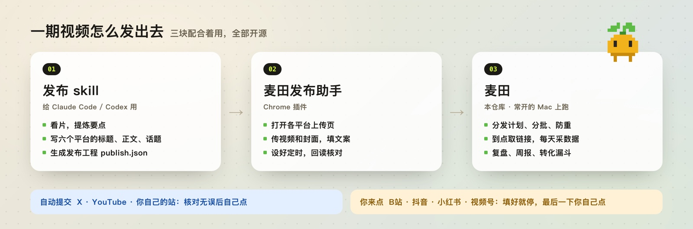

把一条剪好的成片整理成多平台发布工程。为各平台准备标题、正文、话题和封面，再交给麦田填写、调度和跟踪结果。

## 什么时候用

视频剪辑已完成，需要为 B 站、小红书、抖音、视频号、YouTube、X 或 Instagram 准备平台版本，并安排后续分发。

## 交付什么

交付各平台文案、封面清单和 `publish.json`。麦田发布助手负责填写，麦田工作台负责分发计划、状态和链接回填。需要人工确认的平台由你完成最后发布。

[查看发布工程格式与操作步骤](SKILL.md)
